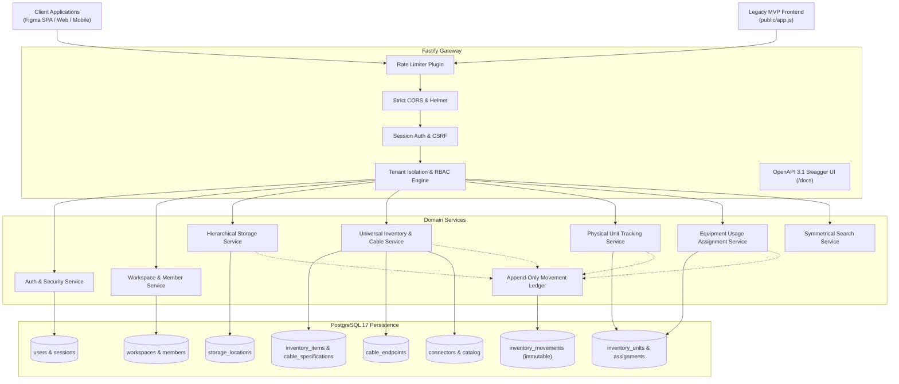
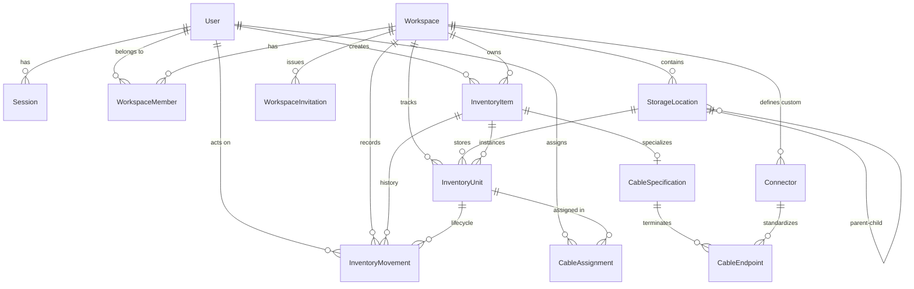

# AGF Drawer — System Architecture & Backend Documentation

## 1. Executive Summary

**AGF Drawer** is an enterprise-grade inventory and asset management platform engineered by AGF Studios. Designed to scale from self-hosted single-workshop homelabs to multi-tenant organization setups, the platform provides:

- **Strict Multi-Tenancy:** Complete tenant isolation across independent workspaces.
- **Universal Inventory Engine:** Extensible category modeling (cables, adapters, electronic components, microcontrollers, networking equipment, devices, and tools) with normalized search keys and validated JSONB extensions.
- **Cable Specialization & Symmetrical Connector Matching:** Independent endpoint modeling where a search for `USB-C` and `USB-A` symmetrically discovers cables regardless of pinout or orientation (`A -> B` or `B -> A`).
- **Physical Unit State Machine:** Clear separation between product definitions and physical serialized units (`STORED`, `IN_USE`, `LOANED`, `MISSING`, `RETIRED`).
- **Hierarchical Storage with Cycle Prevention:** Arbitrary location nesting with cycle detection and cross-workspace isolation.
- **Dedicated Usage Assignment:** Equipment deployment to racks, workstations, or servers with transaction-level audit records.
- **Cryptographic Security Foundation:** Argon2id password hashing, database-backed sessions, Double-Submit CSRF protection, rate limiting, and RBAC authorization.

---

## 2. High-Level Architecture Diagram



---

## 3. Database Schema & Entity Relationships



---

## 4. API Specification & Endpoints

All endpoints are versioned under `/api/v1` and accept/return JSON.

### 4.1 Authentication & Profile
- `GET /api/v1/auth/csrf` — Retrieve synchronizer CSRF token.
- `POST /api/v1/auth/register` — Register account & initialize workspace.
- `POST /api/v1/auth/login` — Authenticate and receive session cookie & token.
- `POST /api/v1/auth/logout` — Revoke active session.
- `POST /api/v1/auth/logout-all` — Revoke all user sessions.
- `POST /api/v1/auth/change-password` — Change password and invalidate other sessions.
- `POST /api/v1/auth/password-reset/request` — Request password recovery token.
- `POST /api/v1/auth/password-reset/confirm` — Confirm password reset.
- `POST /api/v1/auth/verify-email` — Verify email token.
- `GET /api/v1/me` — Retrieve authenticated user profile and memberships.
- `PATCH /api/v1/me` — Update display name and avatar.
- `PATCH /api/v1/me/preferences` — Update language, theme, and timezone.
- `GET /api/v1/me/sessions` — List active sessions.
- `DELETE /api/v1/me/sessions/:id` — Revoke individual session.
- `POST /api/v1/me/deactivate` — Deactivate user account.

### 4.2 Workspaces & Memberships
- `GET /api/v1/workspaces` — List workspaces current user is member of.
- `POST /api/v1/workspaces` — Create new workspace.
- `GET /api/v1/workspaces/:workspaceId` — Get workspace details.
- `PATCH /api/v1/workspaces/:workspaceId` — Update workspace name/settings.
- `POST /api/v1/workspaces/:workspaceId/archive` — Archive workspace.
- `DELETE /api/v1/workspaces/:workspaceId` — Delete workspace (Owner only).
- `GET /api/v1/workspaces/:workspaceId/members` — List members and roles.
- `PATCH /api/v1/workspaces/:workspaceId/members/:memberId` — Update member role.
- `DELETE /api/v1/workspaces/:workspaceId/members/:memberId` — Remove member.
- `POST /api/v1/workspaces/:workspaceId/leave` — Leave workspace.
- `POST /api/v1/workspaces/:workspaceId/transfer-ownership` — Transfer workspace ownership.
- `GET /api/v1/workspaces/:workspaceId/invitations` — List pending invitations.
- `POST /api/v1/workspaces/:workspaceId/invitations` — Invite user via email.
- `DELETE /api/v1/workspaces/:workspaceId/invitations/:invitationId` — Revoke invitation.
- `POST /api/v1/invitations/accept` — Accept invitation with cryptographic token.

### 4.3 Storage Locations
- `GET /api/v1/storage/locations` — List storage locations.
- `GET /api/v1/storage/locations/tree` — Retrieve full nested hierarchy tree.
- `POST /api/v1/storage/locations` — Create storage location.
- `PATCH /api/v1/storage/locations/:id` — Move location or update properties (cycle-checked).
- `DELETE /api/v1/storage/locations/:id` — Delete empty location.

### 4.4 Connectors Catalog
- `GET /api/v1/connectors` — List standard and workspace custom connectors.
- `POST /api/v1/connectors` — Define custom connector for workspace.

### 4.5 Universal Inventory & Cables
- `GET /api/v1/inventory/items` — List universal inventory items.
- `POST /api/v1/inventory/items` — Create universal item (adapter, tool, etc.).
- `POST /api/v1/inventory/items/:id/archive` — Archive item.
- `POST /api/v1/inventory/items/:id/units` — Add physical unit to item.
- `POST /api/v1/cables` — Register cable specification, endpoints & initial units.
- `GET /api/v1/cables/:id` — Get cable details with availability counts.
- `PATCH /api/v1/cables/:id` — Update cable specification.

### 4.6 Physical Units & Assignments
- `GET /api/v1/units` — List physical inventory units with status/location filters.
- `GET /api/v1/units/:id` — Get individual unit.
- `PATCH /api/v1/units/:id` — Update unit status/location (with optimistic concurrency check).
- `GET /api/v1/assignments` — List cable usage assignments.
- `POST /api/v1/assignments/assign` — Assign cable unit to usage location.
- `POST /api/v1/assignments/return` — Return in-use cable unit to storage.
- `POST /api/v1/assignments/move` — Move cable between usage locations.

### 4.7 Search, Stats & Movements
- `GET /api/v1/search` — Symmetrical connector search and multi-filter query.
- `GET /api/v1/stats` — Workspace inventory analytics & availability metrics.
- `GET /api/v1/movements` — Append-only audit trail and movement history.

---

## 5. Security & Isolation Matrix

| Role | Workspace Management | Member Management | Inventory Read | Inventory Edit | Storage Edit | Audit Read |
|---|:---:|:---:|:---:|:---:|:---:|:---:|
| **OWNER** | Full (Delete, Transfer) | Full | Yes | Yes | Yes | Yes |
| **ADMIN** | Update Settings | Invite, Remove, Role Edit | Yes | Yes | Yes | Yes |
| **EDITOR** | None | Read Only | Yes | Yes | Yes | No |
| **VIEWER** | None | Read Only | Yes | No | No | No |

---

## 6. Symmetrical Connector Matching Logic

Cables are registered with distinct endpoints. When an operator queries for a cable linking `USB-C` and `USB-A`:

```sql
SELECT c.* FROM cables c
WHERE (
  (c.endpoint_a = 'USB-C' AND c.endpoint_b = 'USB-A')
  OR
  (c.endpoint_a = 'USB-A' AND c.endpoint_b = 'USB-C')
)
```

The system automatically performs this symmetrical expansion across normalized endpoint records, matching cables regardless of which end was designated Position A or Position B.

---

## 7. Deployment & Operational Runbook

### 7.1 Docker Compose Deployment
```bash
# 1. Clone repository
git clone https://github.com/l3nnardwlg/agf-drawer.git
cd agf-drawer

# 2. Configure environment
cp .env.example .env
# Edit .env with secure random secrets

# 3. Spin up backend and PostgreSQL 17
docker compose up --build -d

# 4. Verify status
docker compose ps
curl http://localhost:3000/health
```

### 7.2 Database Backup and Recovery
```bash
# Backup PostgreSQL 17 database
docker exec -t agf-drawer-postgres pg_dump -U postgres agf_drawer > agf_drawer_backup_$(date +%Y%m%d).sql

# Restore database from dump
cat agf_drawer_backup_20261017.sql | docker exec -i agf-drawer-postgres psql -U postgres -d agf_drawer
```

---

## 8. Frontend Integration Guide (Figma SPA)

The upcoming frontend should interface with the backend as follows:

1. **Authentication:**
   - Call `POST /api/v1/auth/login` with `{ login, password }`.
   - Store session cookie automatically via browser (`credentials: "include"` in fetch) or pass `Authorization: Bearer <token>` in API requests.
   - For browser cookie mutations, fetch `GET /api/v1/auth/csrf` and include the `X-CSRF-Token` header.
2. **Workspace Context:**
   - On workspace selection, pass `X-Workspace-Id: <uuid>` on all requests.
3. **OpenAPI Schema Client Generation:**
   - Generate TypeScript API clients directly from `http://localhost:3000/docs/json`.
